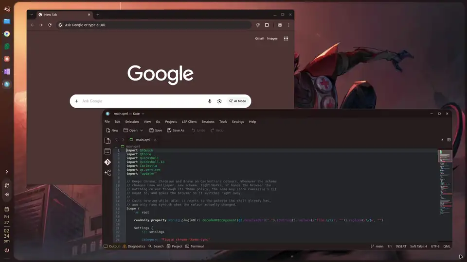
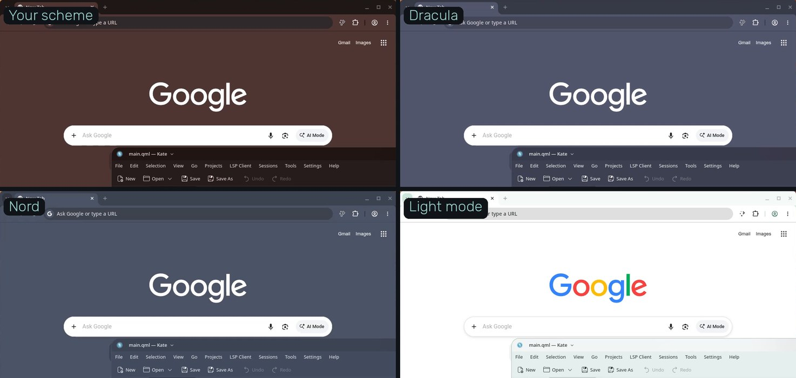

<div align="center">


# Chrome Theme Sync

[](https://github.com/caelestia-kde/caelestia)
[](https://kde.org/plasma-desktop)
[](metadata.json)
[](LICENSE)

</div>

> ✅ Tested and working on Caelestia KDE 2.7.6 (Plasma 6.8.3, Chrome 158).

A Caelestia plugin that makes Google Chrome use the colours of your current scheme. When you
change your wallpaper or scheme, Chrome updates within a second or so. Chromium and Brave are
supported too.

Caelestia's CLI already has code for theming Chrome, but Caelestia KDE never runs it, so Chrome
ends up stuck on whatever colour it was given last. This plugin does it from the shell instead.



Switching schemes: Chrome changes colour about a second later, along with everything else.



## Install

Download the zip from the [latest release](https://github.com/COCONAT10MEN/chrome-theme-sync/releases/latest),
unzip it and double-click **Install**.

You can also paste this into Caelestia's *Settings → Plugins*:

```
https://github.com/COCONAT10MEN/chrome-theme-sync
```

The first time it runs you'll get a password prompt. Chrome only reads theme colours from a
system folder, so the plugin needs admin rights once to set that up. If you cancel, nothing is
changed. Turn the plugin off and on again to get the prompt back.

## Settings

There's one option, **Browser colour**:

- **Background** (default) uses the same dark tone as your panels.
- **Accent** uses your scheme's main colour instead.

## Notes

- Chrome will say "Your browser is managed by your organization". That's how Chrome labels
  anything set from that system folder. The colour is the only thing being set.
- Light and dark mode follow your system setting.
- Chrome's own colour picker is locked while the plugin is installed.

## Updates

The plugin checks for new releases about once a day, and again after Caelestia updates. When
there's one you get a notification where you can update or skip it, and there's an update
button on the plugin in *Settings → Plugins*. It never updates without asking, and you can undo
an update right after installing it.

## Uninstall

Run this first. It removes the colour from your browser and the admin helper:

```bash
sudo sh ~/.config/caelestia/plugins/chrome-theme-sync/helper/setup.sh uninstall
```

Then remove the plugin in *Settings → Plugins*.

## What it adds outside the plugin folder

- `/usr/local/libexec/caelestia-chrome-theme`, a small script that writes the colour file. It
  only accepts a hex colour.
- `/etc/sudoers.d/caelestia-chrome-theme`, which lets your user run that one script without a
  password.
- The colour itself, in `/etc/opt/chrome/policies/managed/caelestia.json` (Chromium and Brave
  use `/etc/chromium/...` and `/etc/brave/...`).

## License

MIT. You're free to use, change and share it. If you build something on top of it, please
credit [COCONAT10MEN](https://github.com/COCONAT10MEN).
